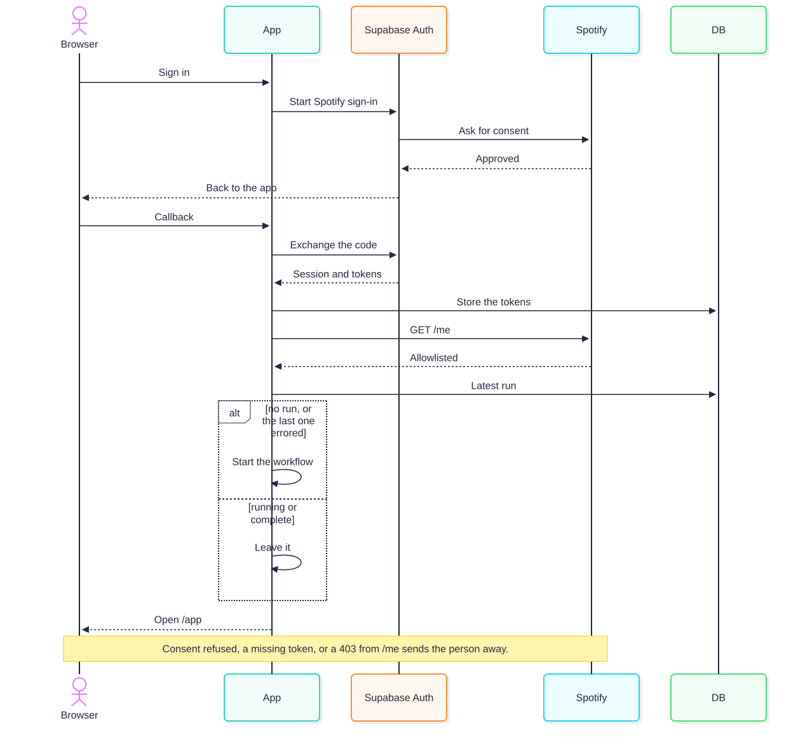
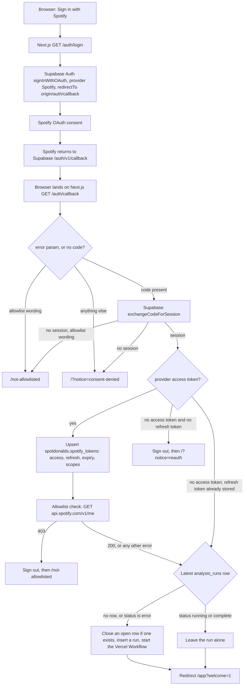
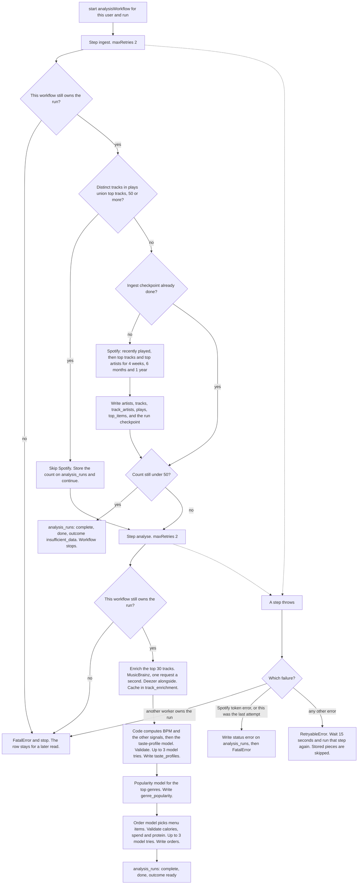
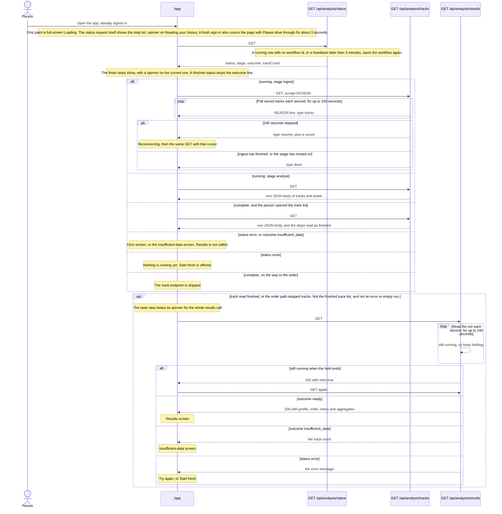

# Architecture

These diagrams follow the code as it runs now. `npm run diagrams` regenerates the SVG and PNG next to each `.mmd` file.

## Spotify login

The browser asks Next.js to start Spotify sign-in through Supabase Auth. The callback stores the provider tokens, checks Spotify's `/me` for the development-mode allowlist, and starts the workflow only when there is no run or the latest one errored. A running or complete run, including `insufficient_data`, is left alone.

Source: [spotify-login.mmd](./spotify-login.mmd). PNG: [spotify-login.png](./spotify-login.png).

## Ingestion workflow

One Vercel Workflow has two steps. Ingest counts distinct tracks already in the database and only calls Spotify when that count is under 50. Fewer than 50 after the fetch ends the run as `insufficient_data`. Analyse then enriches the top 30 tracks, computes the signals in code, and asks the model for a taste profile, a popularity tier, and an order, each checked before it is stored.

Source: [ingestion-workflow.mmd](./ingestion-workflow.mmd). PNG: [ingestion-workflow.png](./ingestion-workflow.png).

## Signed-in page calls

Once `/app` is open, the page reads status, then tracks, then results. Tracks is an NDJSON stream only while the run is still on ingest, and one JSON body after that. Results holds the request for up to 240 seconds and answers 202 with `retry: true` when the run is still going, and the page asks again.

Source: [frontend-calls.mmd](./frontend-calls.mmd). PNG: [frontend-calls.png](./frontend-calls.png).
