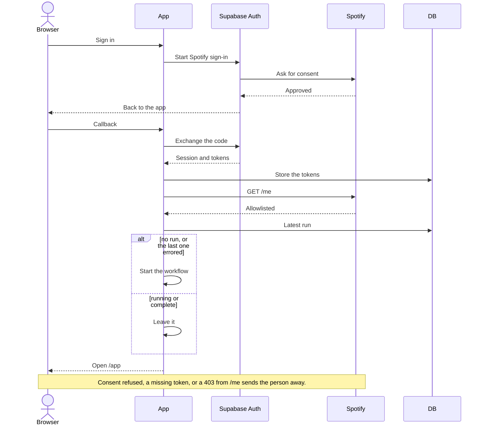
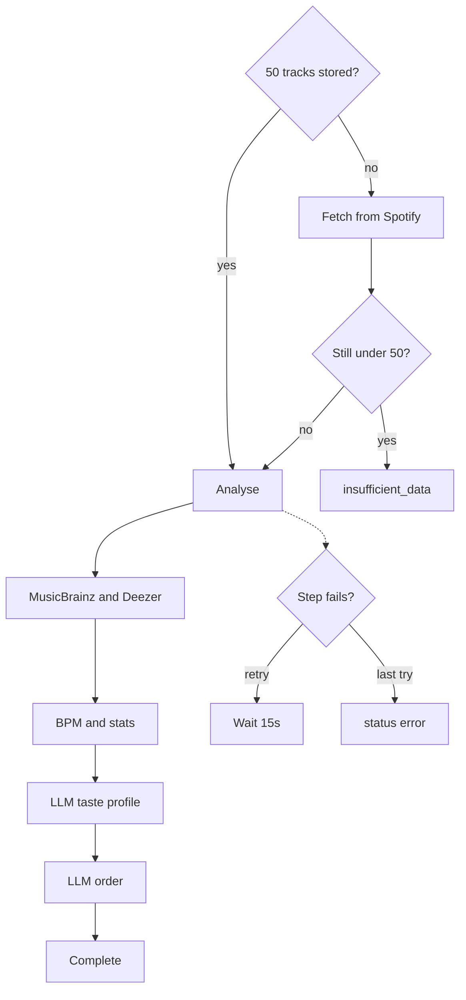
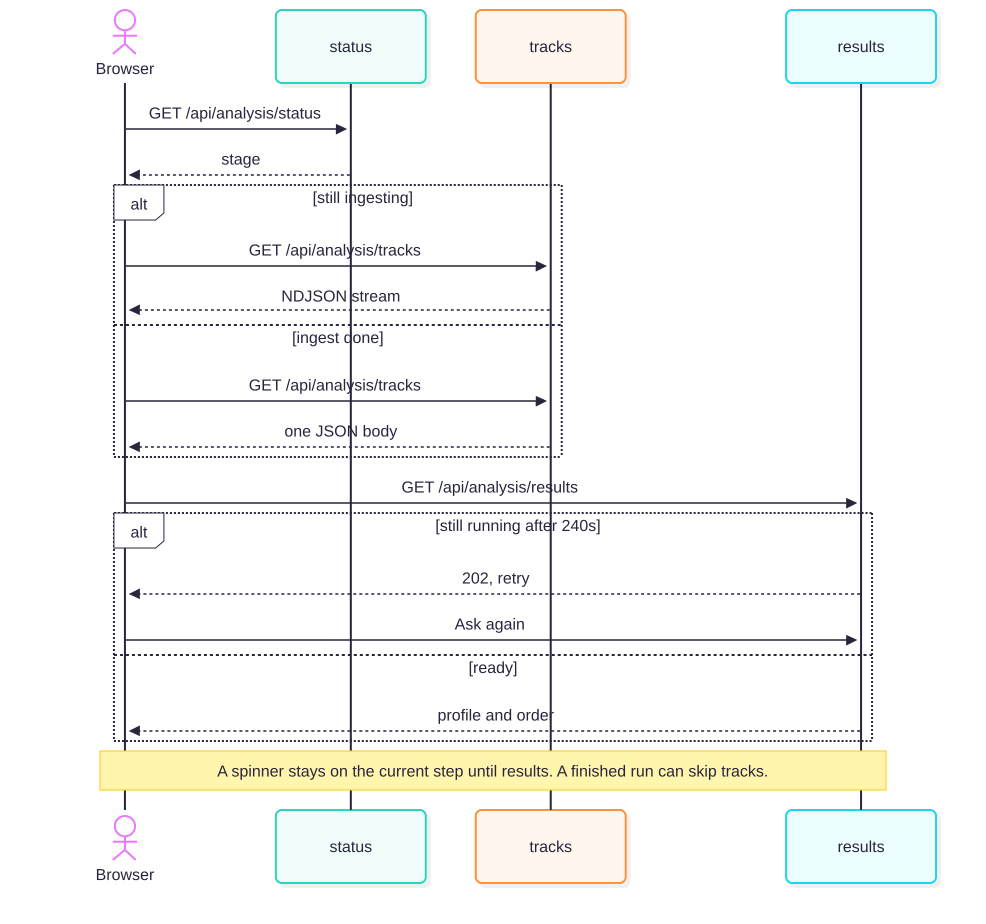
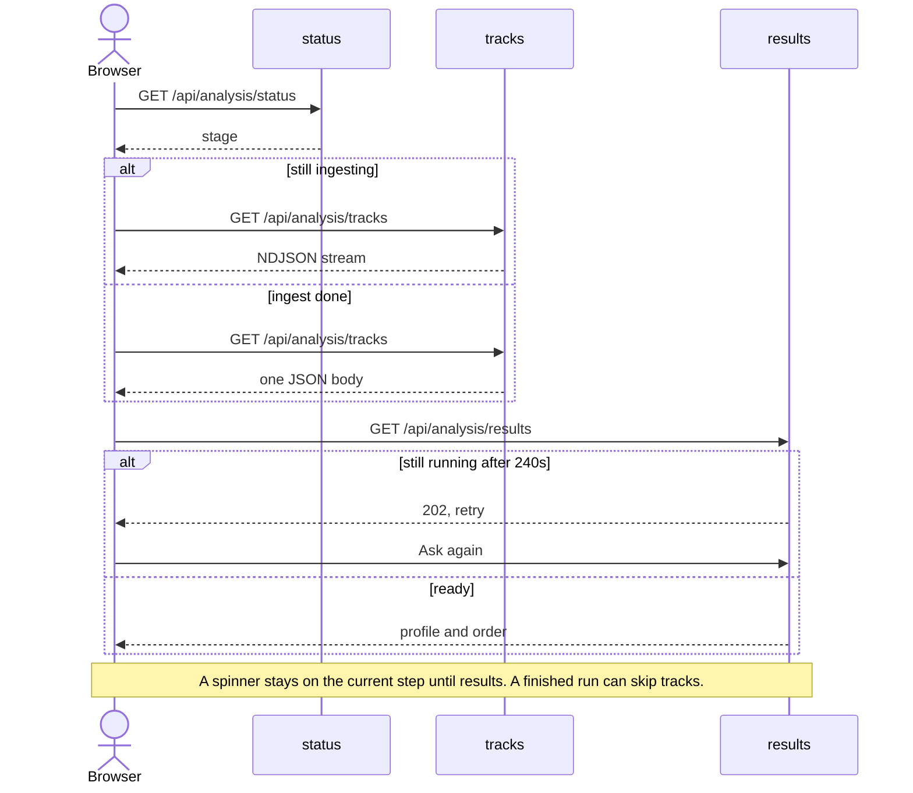

# Architecture

These diagrams follow the code as it runs now. `npm run diagrams` regenerates the SVG and PNG next to each `.mmd` file.

## Spotify login

The browser signs in through the app and Supabase Auth. Spotify grants consent, the callback stores the tokens, and `/me` checks the allowlist. The workflow starts only when there is no run or the latest one errored.

Source: [spotify-login.mmd](./spotify-login.mmd). PNG: [spotify-login.png](./spotify-login.png).

## Ingestion workflow

Ingest uses tracks already stored, and calls Spotify only when there are fewer than 50. Still short of 50 ends the run. Analyse enriches, computes the numbers, then asks the model for the profile and the order. A failed step waits 15 seconds and tries again. The last try writes status error.

Source: [ingestion-workflow.mmd](./ingestion-workflow.mmd). PNG: [ingestion-workflow.png](./ingestion-workflow.png).

## Signed-in page calls

The page reads status, then tracks, then results. Tracks is a stream while ingest is still running, and one JSON body after that. Results holds for up to 240 seconds, then answers 202 so the page can ask again.

Source: [frontend-calls.mmd](./frontend-calls.mmd). PNG: [frontend-calls.png](./frontend-calls.png).

